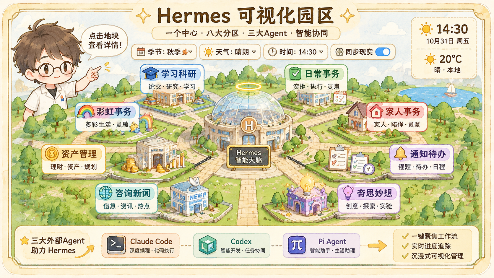
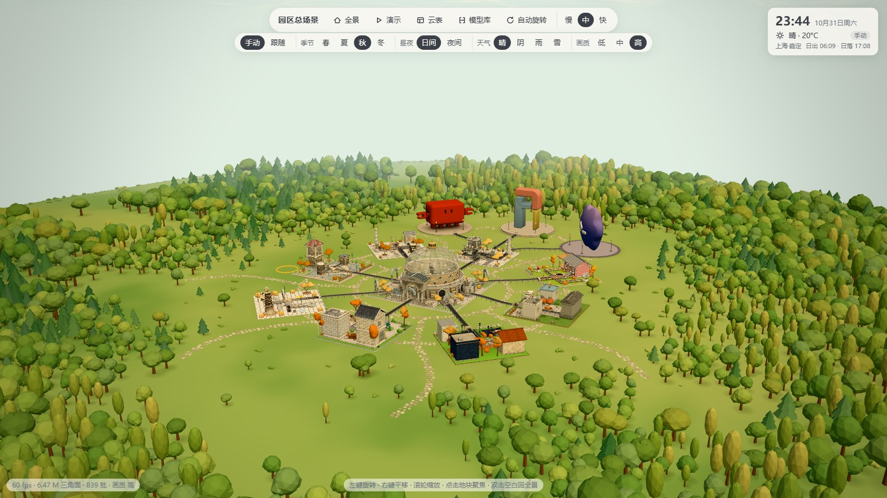
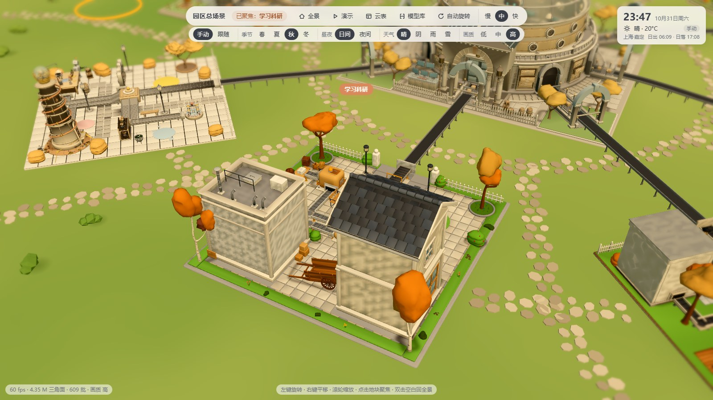
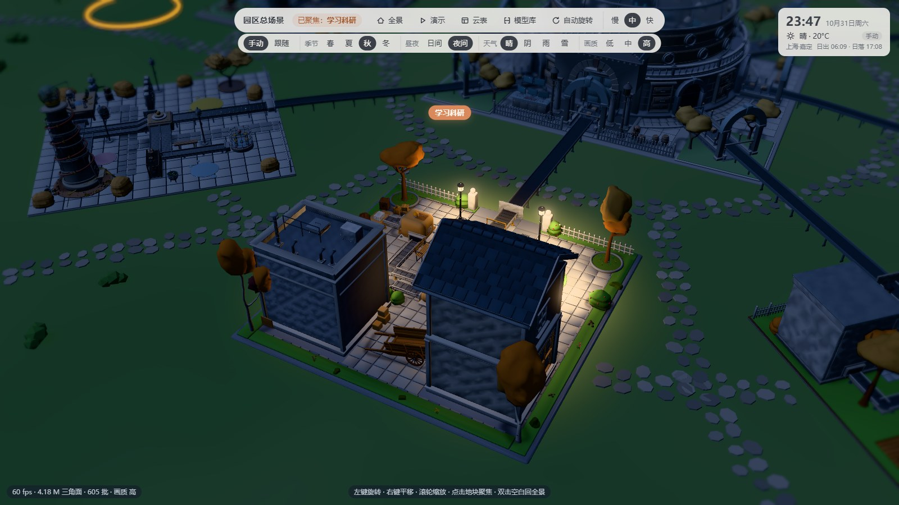

<div align="center">

# Hermes 可视化园区

**把一个人的 AI 工作流，做成一座可以逛的 3D 园区**

12 块地块 · 真实昼夜与天气 · 点地块看职责与待办 · 零依赖本地运行


</div>



## 这是什么

这是一个本地运行的 **3D 等距可视化驾驶舱**：把日常使用的 AI 助手体系拆成一座园区——中央是调度一切的中枢大厅，四周按业务分八块地块，另有三块「外协单位」代表外部编程 agent。

它不只是个好看的模型：点开任意地块能看到这块地**负责什么、此刻在跑什么、有哪些待办**，进度环读的是真实运行状态，而不是写死的假数据。

| 白天全景 | 聚焦地块 | 夜景（只亮聚焦地块） |
|---|---|---|
|  |  |  |

## 功能

**场景**

- **12 块地块**：8 个业务分区 + 3 个外协单位 + 1 个中央大厅，11 条传送带把各地块接到中枢，端点误差 0
- **真实环境**：跟随本地时间与太阳角度，日出日落自动切换昼夜；天气（晴 / 阴 / 雨 / 雪）影响光照、粒子与亮度
- **手动模式**：四季 × 昼夜 × 天气 × 画质三档，随时切换
- **天空**：渐变天穹 + 程序化软边云 + 随太阳方位移动的日轮
- **夜景**：只点亮聚焦地块，另加一盏冷色月光（+9% 亮度，不破坏夜晚感）
- **演示模式**：把一天压成 60 秒看完整昼夜循环

**业务层**

- 点地块弹出三页签：**职责**（这块地接什么活、不接什么）、**此刻**（本周待办 + 定时任务）、**待办 · Cron**
- 待办可勾选并写回数据源
- 左栏本周总览：待办与定时任务分区、按紧急度排序、逾期置顶
- 进度环：定时任务在跑、或该分区会话正在进行时才亮，任务结束自动熄灭
- 事件驱动包裹：有任务才动，跑完回到中枢
- 外协三块作为「摆件」：只展示职责与当前版本号

**性能**

- 模型从 230 MB 压到 **53 MB**（−77%，保结构压缩，面数不变、像素差 0.25%）
- 空闲时渲染从 60 fps 降到 8 fps，静置 CPU 22% → 6%，切到后台不渲染
- 当前场景约 6.5 M 三角面、800+ 批次，主流独显/核显可跑满 60 fps

## 快速开始

需要 Node.js 18+，**没有任何 npm 依赖**（服务端只用 Node 内置模块，three.js 以本地 ESM 副本随仓库提供）。

```bash
git clone https://github.com/yys806/hermes-park.git
cd hermes-park
node server/server.js
```

浏览器打开 <http://127.0.0.1:8788/viewer2/index.html>（模型库：`/viewer/index.html`）。

必须走 HTTP 访问：ES module 与 `.glb` 在 `file://` 下会被浏览器拦。

## 目录结构

```
viewer2/            总场景前端（three.js ESM，主入口 index.html）
  park.js           渲染主循环、相机、光照、聚焦、画质档
  world.js          地面/道路/树林/地形
  belts.js          传送带系统（端点对齐与碰撞自检）
  sky.js sun.js weather.js   天空、太阳、天气
  panel.js          右侧业务面板（职责 / 此刻 / 待办 · Cron）
  leftbar.js        左栏本周总览
  scene.json        地块布局、模型路径、相机参数
  business.json     各地块展示文案
viewer/             模型库：单地块模型查看器
server/             极简 Node 服务（静态文件 + /api/*，零依赖）
src/                早期原型（2D 等距版，保留作参考）
vendor/three/       three.js r180 本地副本
out/models_opt2/    压缩后的 12 个地块 .glb（页面默认加载这一份）
blender/            Blender 建模脚本（PBR 低模 → glb 导出）
scripts/            批量建模、导出、包围盒 / 对称性 / 碰撞校验
docs/               需求规格、共性规范、上线方案、结项复盘
```

## 数据从哪来

`/api/*` 这一层是给本机自动化体系用的，读的是本机 Hermes 的任务队列与待办缓存：

- `/api/live` 聚合各地块此刻状态、定时任务、待办
- `/api/agents` 探测本机外部 agent（Claude Code / Pi / Codex）的版本与是否在跑
- `/api/state` 早期接口，读 `src/state/mock.json`

**在没有本机 Hermes 环境的机器上，业务面板会是空的**——这是预期行为，3D 场景、聚焦、昼夜、传送带全部不受影响。仓库不包含任何个人数据：截图里的待办栏与业务面板都已隐藏，真实任务只留在本机。

## 技术栈

| 层 | 用的什么 |
|---|---|
| 渲染 | three.js r180（ESM，本地副本，无 CDN 依赖） |
| 后处理 | 自研 bloom / 暗角 / 接触阴影 / 色调分级（自定义 shader） |
| 建模 | Blender 脚本化建模，PBR 低模，导出 glTF 2.0 (.glb) |
| 服务 | Node 原生 `http`，静态文件 + JSON API，零第三方依赖 |
| 数据 | 本机任务队列 + 多维表格待办（可选） |

## 建模与验收口径

这套园区是流水线做出来的，规范写在 `docs/园区共性规范.md`，核心几条：

- 8 块功能地块统一 16 × 16 米，中央大厅 25 × 25 米，外协 3 块 20 × 20 米
- 传送带全园统一 0.90 宽 / 0.55 高 / 朝南
- 灯只让灯罩发光，中央室内 3–4 盏，其余地块只做室外 3–5 盏
- **验收看网格密度（≥250）与小件占比（≥0.25），不看文件大小**
- 对称性、传送带端点齐平这类几何事实用脚本数值验证，不靠肉眼

## 文档

- [园区共性规范](docs/园区共性规范.md) — 尺寸、灯光、传送带统一口径
- [需求规格 v2](docs/园区总场景-需求规格-v2.md) / [需求整理 v3](docs/园区总场景-需求整理-v3.md)
- [总场景任务书](docs/园区总场景-任务书.md)
- [上线与优化方案](docs/上线与优化方案.md)
- [结项复盘](docs/园区驾驶舱-复盘.md) — 最终交付清单与六条踩坑心得

## 说明

个人项目，未附开源许可证；代码与模型仅供学习参考，转载或商用请先联系作者。

维护方式：本地改完 `git commit` + `git push`，不另建部署流程——页面本身是纯静态 + 一个零依赖 Node 服务，`git clone` 就能跑。
